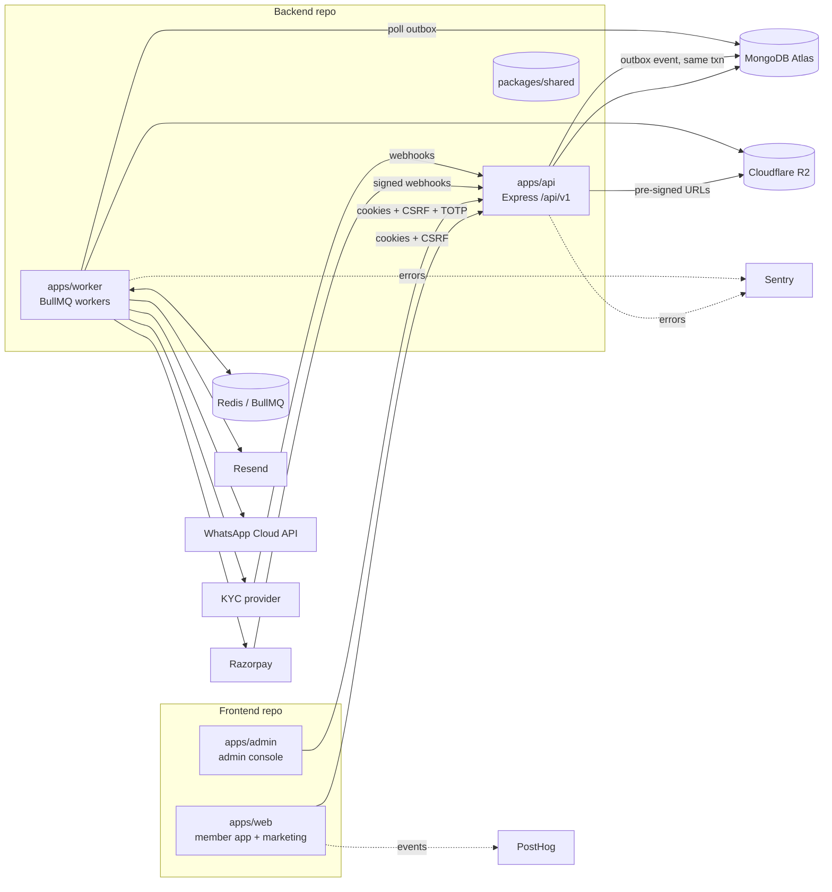

# Architecture

Marchmaker is split across two repositories:

| Repo | Contents |
|---|---|
| `marchmaker_backend` | `apps/api` (Express REST), `apps/worker` (BullMQ + outbox relay), `packages/shared` (Zod schemas, enums, RBAC, state machines), `packages/email` (React Email), `packages/config` |
| `marchmaker_frontend` | `apps/web` (member app + public site), `apps/admin` (admin console), `packages/ui` (design system), `packages/config` |

`@marchmaker/shared` is the single source of truth for types, schemas and state machines.
The frontend repo consumes it through a local path dependency (see `DECISIONS.md`, D-002).

## Principles enforced in code

- **Server is the source of truth.** State transitions go through the machines in `@marchmaker/shared` and are validated in the API.
- **Transactional outbox.** The API writes the domain change and an `outbox` row in one Mongo transaction. The worker relays rows to BullMQ (`jobId = outbox _id` makes publish idempotent), retries with backoff, and parks exhausted jobs on the `dead-letter` queue.
- **No third-party call on a critical path.** Providers sit behind adapters with timeouts, retries and a mock implementation selected by env.
- **Money is integer paise.** GST maths lives in `packages/shared/src/money.ts` and is unit-tested.

## Phase 1 surface

- `GET /healthz`, `GET /readyz`, `GET /api/v1/meta`
- Security middleware: helmet (CSP with nonce, HSTS, frame deny, no-referrer, Permissions-Policy), strict CORS allow-list, hpp, mongo-sanitize, body size limits, rate limiting, request IDs, PII-redacting pino logs.
- Models: `User`, `Session`, `AuditLog` (append-only at model layer), `Outbox`, `Setting`, `FeatureFlag`, `StateTransition`.
- Field encryption: AES-256-GCM with blind index (`apps/api/src/lib/crypto.ts`).
